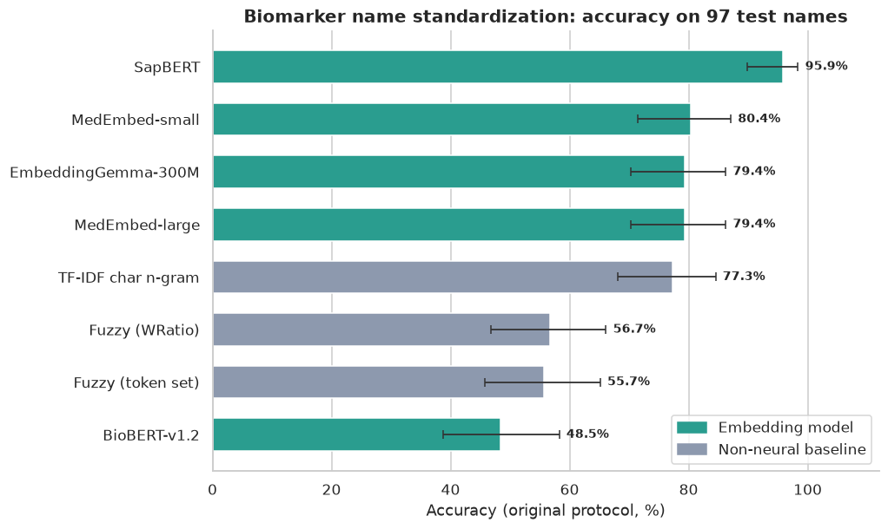
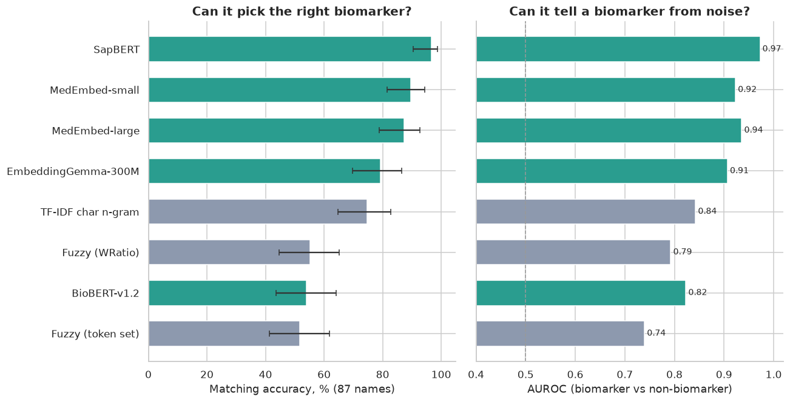
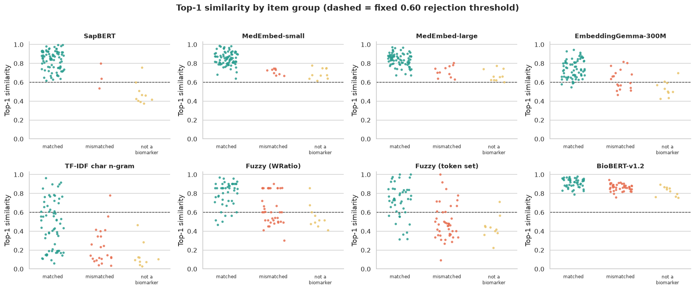

# Biomarker Name Standardization: Embedding Model Benchmark

The same biomarker shows up under different names in different lab reports: "HDL-C direct", "good cholesterol", "HDL Cholesterol". Given a raw name, which canonical biomarker does it refer to, or is it not a biomarker at all (a panel name, a patient field)?

This project compares **five embedding models** and **three non-neural baselines** on that task: 97 raw names mapped to 46 canonical biomarkers, including names that must be rejected.

[](https://colab.research.google.com/github/farazfazal124-bit/biomarker-name-standardization/blob/main/notebooks/biomarker_name_standardization.ipynb)



## Key findings

- **SapBERT is the clear winner:** 95.9% (93/97) on the original protocol, vs 80.4% for the next best model. It also has the best matching accuracy (96.6% on the 87 names that should match) and the best AUROC (0.97). It is a biomedical entity-linking model trained on UMLS synonyms, which is exactly this task. The gap to every other method is statistically significant (exact McNemar, p < 0.001).
- **Much of the original gap is the fixed 0.60 rejection threshold.** MedEmbed and BioBERT give high similarity to everything, even "Patient Name", so they almost never reject (0-10% rejected correctly). On matching alone, MedEmbed-small reaches 89.7% and MedEmbed-large 87.4%, and their AUROC of 0.92-0.94 shows a better threshold would help them. See the score-distribution chart below.
- **A simple baseline is not far behind some models.** Character n-gram TF-IDF gets 74.7% matching and 77.3% on the original protocol, beating BioBERT and both fuzzy-matching baselines and landing within about 3 points of EmbeddingGemma and MedEmbed on the original protocol. The best embedding models beat it clearly on matching (87-97% vs 75%).
- **BioBERT, mean-pooled, is the weakest** (54% matching, below the TF-IDF baseline). A masked-language-model with no similarity training is a poor choice for name matching.
- **Where SapBERT still fails (4 of 97):** "Serum Glutamic-Pyruvic Transaminase" (an ALT synonym) matched to AST, "Serum Iron" matched to Transferrin Saturation, "TSAT" matched to AST, and the panel name "Complete Blood Count" was accepted as WBC.



## Results

| Method | Type | Original protocol | Matching (n=87) | Recall@3 | Rejection (n=10) | AUROC |
|---|---|---|---|---|---|---|
| SapBERT | Embedding | **95.9%** [89.9, 98.4] | **96.6%** | 100% | 90% | **0.972** |
| MedEmbed-small | Embedding | 80.4% [71.4, 87.1] | 89.7% | 92.0% | 0% | 0.923 |
| EmbeddingGemma-300M | Embedding | 79.4% [70.3, 86.2] | 79.3% | 92.0% | 80% | 0.907 |
| MedEmbed-large | Embedding | 79.4% [70.3, 86.2] | 87.4% | 95.4% | 10% | 0.936 |
| TF-IDF char n-gram | Baseline | 77.3% [68.0, 84.5] | 74.7% | 88.5% | 100% | 0.843 |
| Fuzzy (WRatio) | Baseline | 56.7% [46.8, 66.1] | 55.2% | 78.2% | 70% | 0.793 |
| Fuzzy (token set) | Baseline | 55.7% [45.8, 65.2] | 51.7% | 66.7% | 90% | 0.740 |
| BioBERT-v1.2 | Embedding | 48.5% [38.8, 58.3] | 54.0% | 66.7% | 0% | 0.823 |

95% Wilson confidence intervals in brackets. **Original protocol:** a name to match is correct if the top-1 canonical name is right; a name to reject is correct if its best similarity is below 0.60. **AUROC** measures how well the best-match score alone separates real biomarkers from non-biomarkers, independent of any threshold.



More charts are in [`results/figures/`](results/figures/), and per-item results in [`results/per_item_results.csv`](results/per_item_results.csv).

## Method

- **Data** ([`data/`](data/)): 46 canonical biomarkers and 97 raw names. 87 should match a canonical biomarker (abbreviations such as "TSAT", synonyms such as "Somatomedin C", lay terms such as "good cholesterol"); 10 should be rejected (5 panel names such as "CMP", 5 non-biomarker fields such as "Patient Name").
- **Models:** `cambridgeltl/SapBERT-from-PubMedBERT-fulltext` ([CLS] pooling), `abhinand/MedEmbed-small-v0.1`, `abhinand/MedEmbed-large-v0.1`, `google/embeddinggemma-300m`, `dmis-lab/biobert-base-cased-v1.2` (mean pooling).
- **Baselines:** two `rapidfuzz` fuzzy matchers and character 2-4-gram TF-IDF cosine.
- **Scoring:** cosine similarity between each raw name and each canonical name; top-1 is the prediction. Metrics: original protocol, matching accuracy, rejection accuracy, Recall@3, AUROC, Wilson CIs, exact McNemar tests.

## About these results

All numbers and figures come from one executed run of [`notebooks/biomarker_name_standardization.ipynb`](notebooks/biomarker_name_standardization.ipynb) on Google Colab (saved with its outputs). That run reproduces the scores of the earlier single-model experiment exactly ([`notebooks/original_experiment.ipynb`](notebooks/original_experiment.ipynb), also kept with outputs), including SapBERT's 93/97. The notebook also adds the baselines, the separated matching and rejection metrics, and the charts. It is a single run, so differences of a few names are noise.

## Limitations

- **Small, single-author test set** (97 names). The answer key was written and edited while testing, there is no held-out set, and a few labels are debatable (for example "FT4 index" is a calculated index, and "Total Triiodothyronine, Free" is contradictory). Scores are probably somewhat optimistic.
- **One fixed rejection threshold (0.60)** is used for every model, though models score on different scales. Use the matching and AUROC columns for fair comparison. A per-model threshold chosen on a separate split is future work.
- **No real lab-report data** is used here, and no units or multilingual names.
- **Not for clinical use.** This is a benchmark of name matching, not a medical device.

## How to run

```bash
git clone https://github.com/farazfazal124-bit/biomarker-name-standardization.git
cd biomarker-name-standardization
pip install -r requirements.txt
jupyter notebook notebooks/biomarker_name_standardization.ipynb
```

The dataset is tiny, so it should run in minutes on a CPU or a free Colab GPU (model downloads dominate). If a model fails to load, it is skipped and everything else still runs. `google/embeddinggemma-300m` is gated: accept the terms on its Hugging Face page and log in (`huggingface-cli login`) first.

## Repository layout

```
notebooks/   main notebook (shared scoring, baselines, charts) + the original experiment with outputs
data/        canonical biomarkers and the answer key (JSON)
results/     scoreboard, per-item results and figures
```

## Roadmap

- [ ] Held-out evaluation on names from real lab reports (kept out of the answer key)
- [ ] Per-model rejection threshold chosen on a separate split
- [ ] Alias table + SapBERT top-3 + human-review pipeline
- [ ] Units and multilingual names

## License

MIT, see [LICENSE](LICENSE).